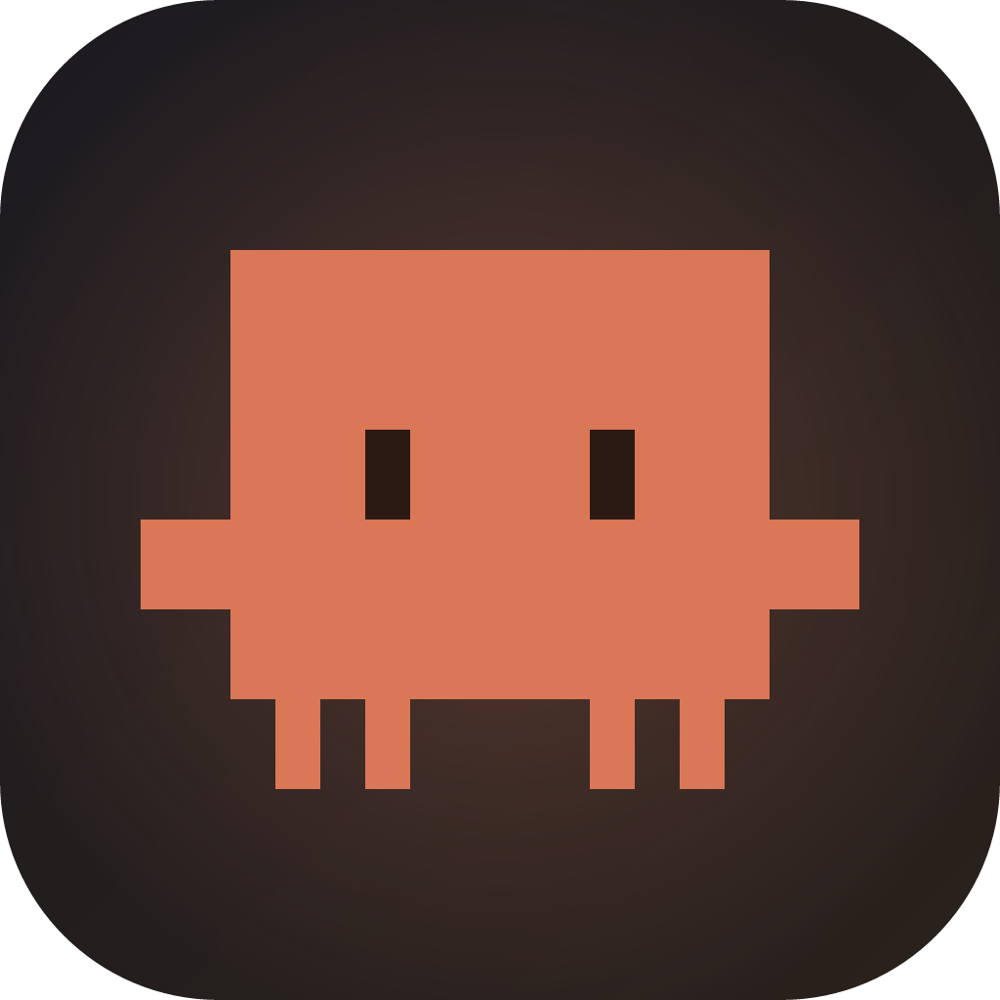
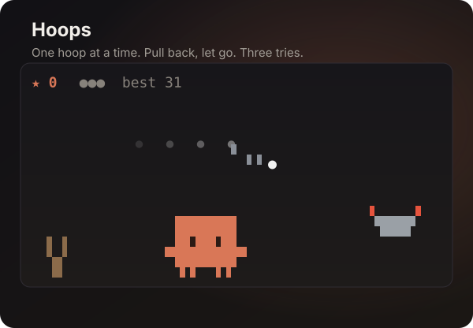
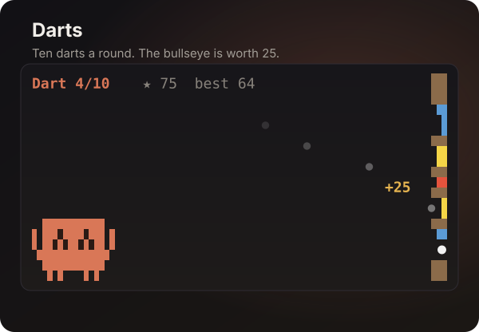
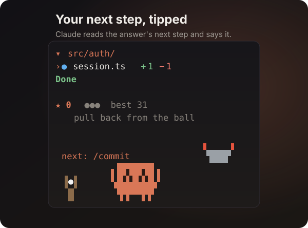

<div align="center">



# claude-code-kit

**A calm companion pane for Claude Code.** See which files Claude changed, see what it and its helpers are doing, and play a small game while it works.

Also included: everyday skills, a set of coding rules, and an output style for staying focused.

[](LICENSE)
[](https://docs.claude.com/claude-code)
[](hooks/companion.test.tsx)
[](CONTRIBUTING.md)

<br>



</div>

<br>

## Install

**macOS / Linux**

```sh
curl -fsSL https://raw.githubusercontent.com/MelvinEdlund/claude-code-kit/main/install.sh | sh
```

**Windows (PowerShell)**

```powershell
irm https://raw.githubusercontent.com/MelvinEdlund/claude-code-kit/main/install.ps1 | iex
```

**Plugin only**, from inside Claude Code:

```
/plugin install companion-kit --marketplace MelvinEdlund/claude-code-kit
```

Next, start `claude` in a terminal at least 110 columns wide and send a prompt. The pane opens beside the chat. You can also open it any time with `/companion`.

<br>

## Why

While Claude works you mostly wait. You can watch the transcript scroll, switch to another tab and lose your train of thought, or poll `git diff` every minute.

claude-code-kit gives that waiting time a place to rest:

- A narrow pane shows what is happening.
- It shows what changed and who is working on it.
- A small game sits below it, in case your hands need something to do.

The pane stays nearly still: **no notifications, no streaks to keep up, nothing blinking for your attention.** When Claude is done, its speech bubble names the next step.

<br>

## What's in the kit

| | |
| --- | --- |
| 🦀 **Companion pane** | Changed files grouped by folder. Click a file to fold out its change; hover it to see the full path. Two calm status lines, and a focus timer that suggests a break after a long stretch. |
| 🧑‍🤝‍🧑 **Helpers** | Every subagent Claude starts joins the pane: Bea the builder, Tess the tester, Rex the reviewer and more. Each has a name, a hat and a level, and shows a short label of what it is doing right now. |
| 🏀 **Two small games** | Hoops and darts, picked at random each session. Skill-based, no timers, best scores kept. |
| 💬 **Next-step tips** | When an answer ends with `Next step: /something`, Claude shows that command in a speech bubble. |
| 📈 **Levels from real work** | Tokens Claude spends level it up; helpers level from their own work. A new ball arrives every 100k tokens. |
| 🛠️ **Skills** | `/commit`, `/pr-check` and `/spec`: safe commits, a pre-flight check before a pull request, and a spec before you build. |
| 📏 **Coding rules** | Short, general rules Claude follows in every project: read before editing, no duplication, a changed test is a claim, report honestly, confirm before anything destructive. |
| 🎯 **Focus output style** | Optional. Answers put the next action first, use numbered steps and visible wins, and end with one next step. |

<br>

## The games

<table>
<tr>
<td width="50%"></td>
<td width="50%"></td>
</tr>
<tr>
<td>

**Hoops.** The ball sits in a slingshot at the bottom left. Pull back from it and let go. It flies on a real arc, bounces off the walls, and can bounce off Claude too. Each hoop gives you three tries. A hit moves the hoop to a new height. A swish, or a hit on the first try, scores extra.

</td>
<td>

**Darts.** Ten darts a round, thrown from a peg at a board on the far wall. The rings score more toward the middle, and the bullseye scores 25. Throws that fall short score nothing. Beat your best round.

</td>
</tr>
</table>

You can pick Claude up in either game and throw it around. It bounces off the walls, lands, and walks back to its spot. Switch games with `/game`.

<div align="center">

</div>

<br>

## Meet the helpers

When Claude starts a subagent, a small character joins the playground. Agent types the kit does not know get Hal, a plain helper.

| Agent type | Name | Role | Look |
| --- | --- | --- | --- |
| `Explore` | Sam | Scout | deerstalker |
| `Plan` | Pip | Planner | top hat |
| `general-purpose` | Hal | Helper | none |
| `explorer` | Ivy | Explorer | safari hat |
| `implementer` | Bea | Builder | hard hat |
| `test-writer` | Tess | Tester | cap |
| `code-reviewer` | Rex | Reviewer | glasses |
| `security-reviewer` | Sid | Security | helmet |
| `ui-reviewer` | Uma | Designer | beret |

Helpers keep their levels from one session to the next.

<br>

## Commands and skills

| Command | What it does |
| --- | --- |
| `/companion` | Opens the companion pane. Press Esc to return to the prompt. |
| `/game` | Switches between hoops and darts. |
| `/commit` | Commits and pushes safely. It never commits on `main` and never force-pushes or skips hooks. |
| `/pr-check` | Checks for conflicts and overlapping files against the target branch and runs your checks. It then prints the exact `gh pr create` command. |
| `/spec` | Writes the goal, testable acceptance criteria and exact changes before any code. Unclear points become questions to you. |

When a name clashes with a command you already have, the plugin skills are also available with a prefix: `/companion-kit:commit` and so on.

<br>

## What the installer does

The installer is safe to run again. It updates what it installed and **never overwrites your own files.**

1. It clones the kit to `~/.claude/claude-code-kit`, or updates an existing copy.
2. It installs the plugin through Claude Code's plugin marketplace.
3. It adds one import line to `~/.claude/CLAUDE.md`, so Claude follows [the coding rules](config/CLAUDE.md). Your own rules stay where they are.
4. It sets `"tui": "fullscreen"` in `~/.claude/settings.json`, but only if you have not chosen a `tui` value yourself. The pane docks in the fullscreen view.
5. It copies the [Focus output style](config/output-styles/focus.md) to `~/.claude/output-styles/`. Turn it on with `/output-style focus`.

To skip a step, set its variable when you run the installer:

```sh
KIT_RULES=0 KIT_STYLE=0 sh install.sh     # plugin and fullscreen view only
```

<br>

## Design principles

- **Calm over clever.** Motion is slow and small. The pane is something you glance at, not something to watch.
- **Useful first, fun second.** The game sits below the information, never on top of it.
- **No pressure.** No streaks to protect, no daily goals, nothing you can lose by stepping away.
- **Local only.** The kit reads Claude Code's own events and keeps scores and levels in Claude Code's plugin store, on your machine. It makes no network requests and collects no data.

<br>

## FAQ

<details>
<summary><b>The pane doesn't show up.</b></summary>

The pane docks in the fullscreen view, beside the chat, when the terminal is at least 110 columns wide. Widen the window or run `/companion`. Check that `~/.claude/settings.json` has `"tui": "fullscreen"`. In VS Code the pane shows the figure and the status lines without a game.
</details>

<details>
<summary><b>Does it slow Claude down?</b></summary>

No. The pane only listens to events Claude Code already produces, such as a tool call or a finished turn. It adds nothing to your prompts or to the context Claude sees.
</details>

<details>
<summary><b>Can I use only the pane, and not the rules or the output style?</b></summary>

Yes. Use the plugin-only install line above, or set `KIT_RULES=0 KIT_STYLE=0` when you run the installer.
</details>

<details>
<summary><b>How do levels work?</b></summary>

Every 1,000 fresh tokens Claude spends gives it one point; tokens read back from the cache do not count. Level *n* needs 50 × (n−1)² points, so each level takes a little longer than the last. Helpers earn points from their own work.
</details>

<br>

## Uninstall

```sh
claude plugin uninstall companion-kit
```

If you used the installer, also remove the `@…/claude-code-kit/config/CLAUDE.md` line from `~/.claude/CLAUDE.md`. Then delete `~/.claude/claude-code-kit` and, if you added it, `~/.claude/output-styles/focus.md`.

<br>

## Contributing

Ideas, new games, new helpers and bug reports are all welcome. See [CONTRIBUTING.md](CONTRIBUTING.md). The one rule: keep it calm.

## Credits

- The Focus output style is adapted from [ayghri/i-have-adhd](https://github.com/ayghri/i-have-adhd) (MIT).
- claude-code-kit is a community project. It is not affiliated with or endorsed by Anthropic.

## License

[MIT](LICENSE) © MelvinEdlund
